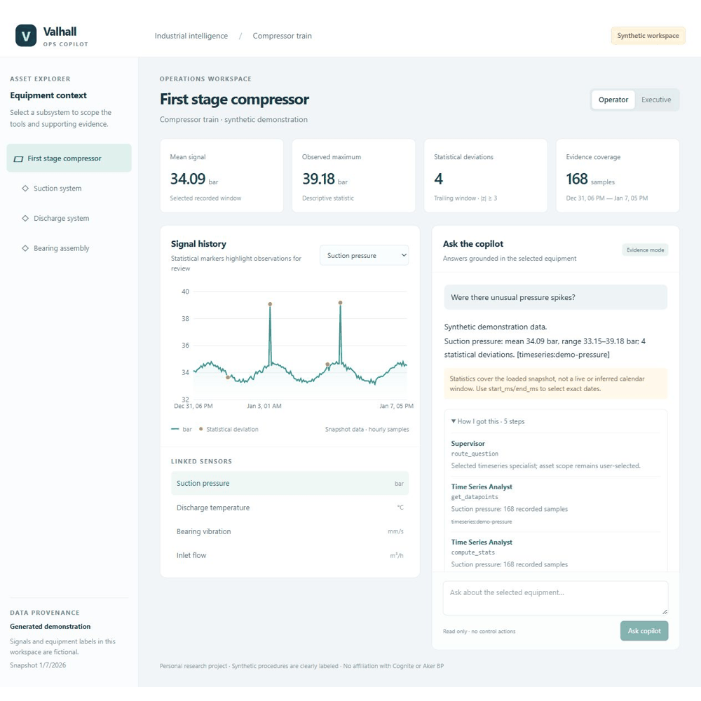
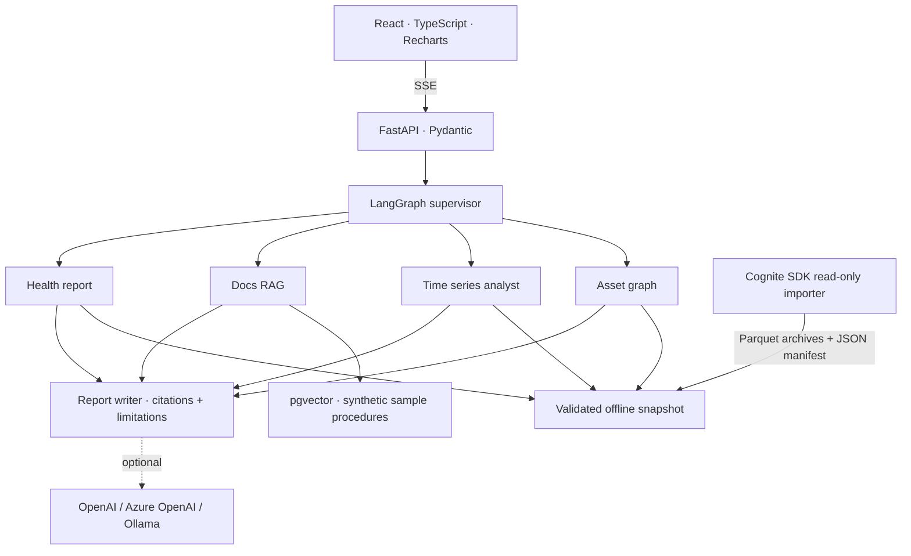

# Valhall Ops Copilot

[](https://github.com/jatinmallarapu/ValhallOperationsCopilot/actions/workflows/ci.yml)
[](LICENSE)

An evidence-first industrial operations assistant with LangGraph specialists,
a React workspace, and a read-only Cognite Data Fusion snapshot importer.



*30-second walkthrough assembled from actual local UI captures. Synthetic data; no live CDF connection.*

**Runs without credentials.** The bundled workspace contains generated compressor
signals and twelve clearly labeled synthetic procedures. Real Open Industrial
Data acquisition is supported by the SDK adapter but has **not** been authenticated
in this build. This is a personal project, not affiliated with Cognite or Aker BP.

## Measured scope

| Check | Initial measured result | What it establishes |
| --- | --- | --- |
| Routing regression | 20/20 | Expected specialist on curated, known questions |
| Tool trace regression | 20/20 | Expected tool actually executed |
| Mean full response | 61.77 ms | Local in-process synthetic replay, extractive writer |
| Live CDF access | Not verified | Requires user-issued credentials |
| Industrial anomaly accuracy / LLM faithfulness | Not measured | Requires independent labels and provider evaluation |

See [evaluation protocol](docs/evaluation.md) for the limitations of these numbers.

## Why build this?

An operator needs equipment context, sensor evidence and an approved procedure—not
an unsupported diagnosis. This project makes those boundaries visible: select an
asset, inspect a signal, ask a question, and inspect the specialist/tool trace and
citations behind the answer. Executive mode summarizes the same evidence without
inventing a health score.

## Quickstart

Requires Docker with Compose. The default stack binds to your own machine only.

```sh
git clone https://github.com/jatinmallarapu/ValhallOperationsCopilot.git
cd ValhallOperationsCopilot
docker compose up --build
```

Open **http://localhost:8000**. Compose starts PostgreSQL/pgvector, idempotently
indexes the sample procedures, then serves the built React UI and FastAPI together.
No API keys, CDF subscription, model download or GPU is needed for this mode.

Try “What sensors are on this compressor?”, “Were there unusual pressure spikes?”,
“Find the discharge temperature alarm procedure.” or “Summarize compressor health
for my VP.” Expand **How I got this** to see each tool and evidence ID.

## System design



- Asset scope is enforced before graph execution, including sensor ownership.
- Statistical analysis uses preceding-window z-scores; chart deviations are not
  plant alarms. Every answer identifies synthetic data and snapshot limitations.
- SSE streams executed steps followed by a structured answer. The trace is tool
  provenance, not hidden model chain-of-thought.
- Retrieval uses fixed lexical vectors in both local mode and pgvector. No paid
  embedding service is required. Empty evidence produces an explicit abstention.
- The default writer is deterministic. Optional LLMs draft evidence-based prose;
  provider failures fall back to recorded tool evidence.

Read the [architecture and decisions](docs/architecture.md) and
[CDF access/replay guide](docs/cdf-access.md).

## Local development and reproduction

Python 3.12+, Node 22+, and an isolated environment are recommended.

```sh
python -m venv .venv
# Activate .venv using the command for your shell.
python -m pip install -e '.[dev]'
npm --prefix frontend ci
npm --prefix frontend run build
uvicorn app.main:app --host 127.0.0.1 --port 8000
```

`make test`, `make lint` and `make eval` run the API tests, static checks and
routing evaluation. The equivalent Windows commands are `python -m pytest`,
`python -m ruff check .`, `python -m mypy backend/app` and `python scripts/evaluate.py`.
Generate the same synthetic fixture with `python scripts/make_demo.py` (seed 24).
For UI development run `npm --prefix frontend run dev` alongside the backend.
Vite proxies `/api` to port 8000.

## API

| Method | Route | Result |
| --- | --- | --- |
| GET | `/api/health` | Source, acquisition timestamp, writer provider |
| GET | `/api/assets` | Available asset hierarchy |
| GET | `/api/assets/{id}` | Asset, direct children, descendant-linked sensors |
| GET | `/api/timeseries/{id}?start_ms=&end_ms=` | Samples, statistics, deviations |
| POST | `/api/chat` | SSE `step`, `answer`, or `error` events |

Chat JSON includes `question`, `asset_id`, optional `timeseries_id`, `start_ms`,
`end_ms`, and `mode` (`operator` or `executive`). Date ranges are start-inclusive
and end-exclusive. Natural-language dates are not parsed: without explicit epoch
milliseconds, analysis covers the loaded snapshot and says so.

## Optional language providers

Copy `.env.example` locally and load the values into your environment; the app
does not implicitly read `.env`. Choose `LLM_PROVIDER=openai`, `azure`, or `ollama`.
Set `LLM_MODEL`; OpenAI uses `LLM_API_KEY` and optionally `LLM_BASE_URL`, Ollama
uses its OpenAI-compatible base URL (for example `http://localhost:11434/v1`),
and Azure uses `AZURE_CHAT_URL`, `AZURE_API_VERSION` and `LLM_API_KEY`.
See `backend/app/llm.py` for the exact interface. These are configurable adapters,
not claims of live provider testing. Evidence sent to a remote provider must be
approved for that destination. Keep `extractive` for fully local execution.

## Repository map

| Path | Responsibility |
| --- | --- |
| `backend/app/graph.py` | Supervisor, specialists, streaming evidence writer |
| `backend/app/cdf_client.py` | Bounded read-only SDK acquisition |
| `backend/app/data.py`, `tools.py` | Scope validation and signal statistics |
| `backend/app/rag.py`, `index_docs.py` | Local/pgvector retrieval and indexing |
| `frontend/src/` | Asset explorer, traceable chat, charts, executive mode |
| `data/synthetic_docs/` | Twelve authored educational procedures |
| `backend/tests/` | API, graph and mocked integration regressions |
| `docs/` | Decisions, provenance, measurement protocol |

## Limitations and next steps

The router is vocabulary-based, with one specialist route per question. Retrieval
is lexical. No live alerts, forecasting, root-cause diagnosis, process control,
authentication or multi-tenant authorization is implemented. The default deployment
is a local portfolio demo. Hourly aggregates may hide fast transients; statistical
deviations do not establish equipment failures. Optional LLM wording needs human
grounding review. CDF authentication and real-data evaluation remain unverified.

Next: authenticate a user-authorized CDF snapshot; evaluate held-out operator
questions and retrieval relevance; add approved procedure versioning, semantic
embeddings, asset authorization and deployment audit controls before shared use.

## Data credits

[Open Industrial Data](https://github.com/cognitedata/open-industrial-data) is an
Aker BP and Cognite collaboration covering Valhall compressor equipment. That
dataset motivates the integration; it is **not** the source of the bundled fixture.
The generated fixture and authored documents are distributed with this project's
MIT license. Real CDF data retains its original terms. No access credentials,
model weights or proprietary maintenance procedures are committed.
