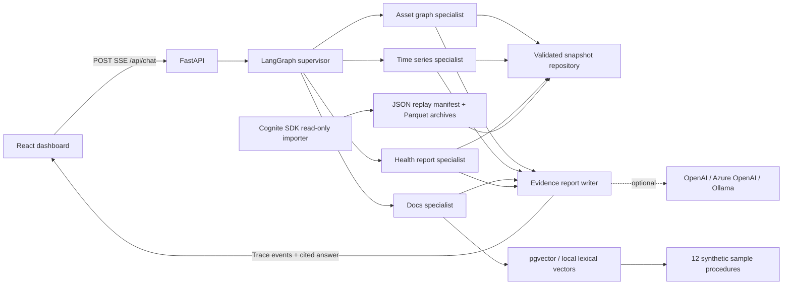

# Architecture and boundaries

CDF acquisition is a separate bounded command. It never runs during a chat request.
The browser and backend share an origin; the database is not exposed to the host.
The default answer writer formats computed evidence without an external model.
Optional models draft wording from the same records; they do not choose tools or
write to equipment. Trace records show executed graph nodes and tool inputs/outputs
by evidence ID, not private model reasoning.

## Decisions

**Supervisor:** a deterministic vocabulary router is predictable and cheap for four
intents. LangGraph controls conditional transitions and streaming state. It is not
an autonomous planner; mixed intents and unfamiliar wording are known weaknesses.
The twenty-question fixture is a regression set, not held-out validation of a
general industrial assistant.

**Offline first:** JSON is the validated replay manifest, while Parquet preserves
the acquired asset and series tables. This separates credentialed acquisition from
a reproducible demo. Acquisition time and sample timestamps are distinct. No live
CDF connection or Academy completion is implied by running the synthetic workspace.

**Retrieval:** 512-dimensional normalized feature-hashing vectors avoid a model
download and embedding API. The same representation is used by local NumPy cosine
search and pgvector. It is lexical retrieval, not a trained semantic embedding.
The database indexer is an idempotent upsert over the twelve sample documents.

**Two modes:** operators get detailed evidence and an executive summary gives a
shorter context paragraph. Both retain citations and the same statistical caveats.
Neither mode asserts machine health, root cause, or permission to operate equipment.

**Anomalies:** compare each hourly sample with the preceding 24 samples after a
12-sample warmup; flag absolute z-score ≥ 3. The current sample is excluded from
its baseline. A constant baseline produces no z-score flag. These are statistical
deviations, not calibrated process alarms. Hourly averages can hide short spikes.

## Before a shared deployment

The local demo has no authentication, tenant isolation, audit retention, or TLS.
Keep its loopback binding. A real installation requires identity-aware asset
authorization, secret management, read-only CDF capabilities, bounded quotas,
approved procedure ownership, access logs with redaction, and independent grounding
evaluation for the selected model. Do not expose this Compose configuration publicly.
